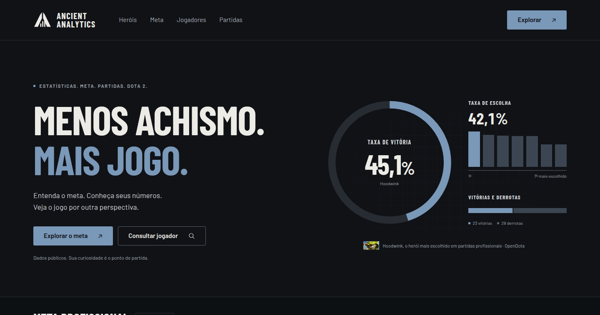
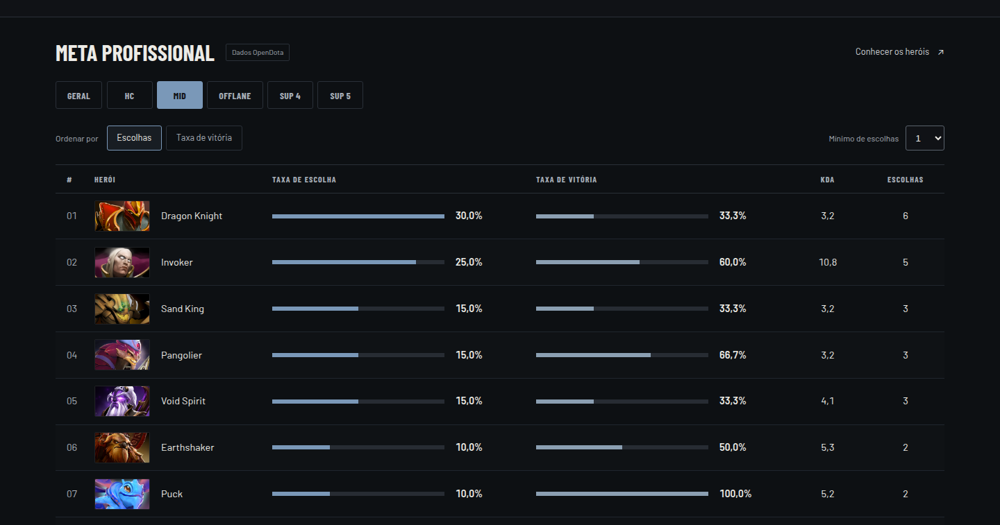
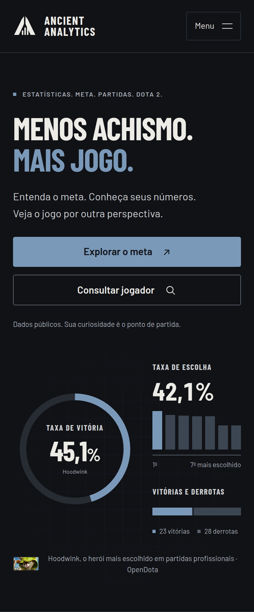

# Ancient Analytics

**Menos achismo. Mais jogo.** Ancient Analytics é uma aplicação web para entender Dota 2 com dados: o que o cenário profissional está jogando, como cada herói se sai em cada posição e como foram as partidas de um jogador, partida a partida.



## A ideia

Muita decisão em Dota 2 é tomada no "eu acho": qual herói está forte, o que os profissionais escolhem no mid, se aquela partida foi perdida por causa de um jogador. O Ancient Analytics junta os dados públicos da [OpenDota](https://www.opendota.com/) numa interface direta, em português, para responder a essas perguntas com números:

- **Meta profissional:** quais heróis são mais escolhidos e quais mais vencem nas partidas profissionais, no geral ou por posição (HC, Mid, Offlane, Suporte 4 e Suporte 5).
- **Heróis e builds:** catálogo completo com busca pelo nome e retratos que abrem a página de cada herói. Consulte sequências de compras por posição, itens iniciais, habilidades e talentos observados em partidas profissionais, com as imagens do Dota e os limites da amostra visíveis.
- **Jogadores:** o perfil público de qualquer conta, buscando pelo ID de amigo, SteamID64 ou link de perfil, com medalha, ranking e histórico de partidas.
- **Partidas:** placar, duração, modo e o desempenho de cada jogador dos dois times: K/D/A, ouro e experiência por minuto, dano, cura e últimos golpes.

Não é preciso login: tudo vem de dados públicos. Quando um dado não está disponível, a interface mostra "—", sem confundir ausência de informação com zero.





## Como executar

Requisitos: [Go](https://go.dev/) 1.26 ou superior e [Node.js](https://nodejs.org/) com npm. Não é preciso banco de dados, Docker nem chave de API.

Em um terminal, inicie a API:

```bash
cd backend
go run ./cmd/api
```

Em outro terminal, inicie a interface:

```bash
cd frontend
npm install
npm run dev
```

Abra o endereço exibido pelo Vite, normalmente http://localhost:5173. A API escuta apenas nesta máquina, em `http://127.0.0.1:8080`, e o Vite repassa a ela as requisições de `/api`.

Para experimentar: busque um herói pelo nome no topo ou clique no retrato para consultar suas builds; abra uma aba de posição no meta profissional (a primeira consulta leva alguns segundos, pois monta uma amostra de partidas), busque um jogador pelo ID de amigo e clique em "Detalhes" numa partida do histórico.

## Documentação técnica

- [backend/README.md](backend/README.md): rotas da API, parâmetros, formatos de resposta, erros e testes.
- [frontend/README.md](frontend/README.md): organização dos componentes, comportamento de cada tela e decisões de interface.
